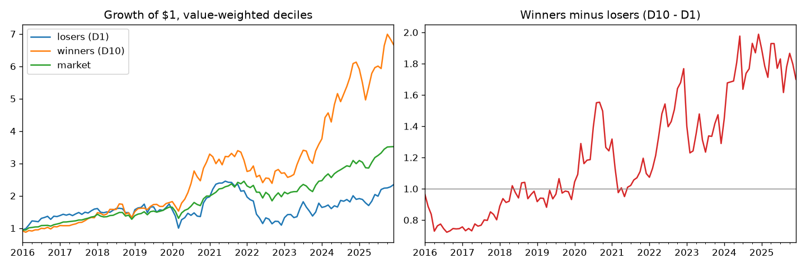

# quant-research-dataset

[](https://github.com/Hardy-Z/quant-research-dataset/actions/workflows/ci.yml)


**One Python API for research-grade market data across markets.** Equities,
fundamentals, index options, rates and ETFs live in a versioned, partitioned
Parquet dataset on the Hugging Face Hub. The package downloads only the
partitions a query touches, pushes filters down into the Parquet scan and
returns clean, documented `pandas` DataFrames.

```python
import quant_research_dataset as qrd

# Every US common stock's daily return in 2024 (one ~90 MB partition, cached after the first call)
stocks = qrd.load(
    "us/equity/stock_daily",
    start="2024-01-01",
    end="2024-12-31",
    columns=["date", "permno", "gvkey", "ret", "mktcap"],
    common_only=True,
)

# Point-in-time fundamentals, joined without look-ahead bias
fund = qrd.get_fundamentals("quarterly", columns=["gvkey", "datadate", "atq", "ceqq"])
panel = qrd.merge_fundamentals(stocks, fund)

# SPX options for a day, with mid price, days to expiry, spot and a matched zero rate
chain = qrd.get_spx_options("2024-03-15", with_market=True)
```

## Why

Academic-quality data (CRSP, Compustat, OptionMetrics) is powerful but awkward:
wide vendor tables, cryptic codes, strikes stored ×1000, link tables with date
ranges, fiscal dates that leak the future. Every project re-implements the same
cleaning. This library does it once, in tested code, behind a small API:

| Problem | What the library does |
|---|---|
| Multi-GB files, slow to load | Year/month partitions + a manifest, so `load(start=..., end=...)` fetches only what it needs |
| Different column names per vendor | Every dataset has a typed schema, snake_case names, units and descriptions in one YAML file |
| Look-ahead bias in fundamentals | `point_in_time=True` adds `available_date` (report date, or a conservative lag) |
| Joining stocks to company fundamentals | Links are applied at build time: stock rows carry `gvkey`, fundamentals carry `permno`; `merge_fundamentals()` joins point in time |
| "Common stocks only" screens | `common_only=True` applies the CIZ-flag equivalent of `shrcd in (10, 11)` |
| Option chains need context | `mid`, `spread`, `dte`, `spot`, `moneyness` and an interpolated zero rate |
| US-only tools | Market-neutral design: `market/asset_class/dataset` ids, per-market adapters |

## Datasets

| Id | Content | Source | Coverage |
|---|---|---|---|
| `us/equity/stock_daily` | Daily prices, returns, volume and market cap of all US-listed stocks, incl. delisted, with linked `gvkey` | CRSP | 2015–2025, 23.1M rows |
| `us/fundamentals/quarterly` | Quarterly financial statements, 60+ items, with linked `permno` | Compustat | 2000–2026, 1.05M rows |
| `us/fundamentals/annual` | Annual financial statements, 60+ items, with linked `permno` | Compustat | 2000–2026, 255K rows |
| `us/options/spx_option_prices` | S&P 500 index option quotes, implied vol and greeks | OptionMetrics | 2015–2025, 34.3M rows |
| `us/options/spx_vol_surface` | Standardized S&P 500 implied volatility surface | OptionMetrics | 2015–2025 |
| `us/index/spx_daily` | S&P 500 index daily OHLC | OptionMetrics | 2015–2025 |
| `us/rates/zero_curve` | USD zero-coupon yield curve | OptionMetrics | 2015–2025 |
| `us/etf/daily_bars`, `bars_5min`, `bars_1min` | SPY, QQQ, IWM, TLT, IEF, GLD bars | Alpaca (local only) | 2016–2026 |
| `cn_hk/equity/daily_bars`, `ah_pairs` | China A/H dual-listed shares | Yahoo Finance (local only) | 2014–2026 |
| `cn_hk/fx/daily` | CNY/HKD, USD/HKD exchange rates | Yahoo Finance (local only) | 2014–2026 |

Datasets marked *local only* are not on the Hub because of their vendor terms; build them
from your own copy with `qrd build`. Full column-level documentation: [docs/datasets.md](docs/datasets.md), or
`qrd.describe("us_stock_daily")` in Python.

## Install and get access

```bash
pip install quant-research-dataset            # add [duckdb] for SQL
huggingface-cli login                         # once; the dataset is gated
```

The data is gated: request access on the dataset's Hugging Face page and
confirm you are entitled to use the underlying vendor data (see
[License](#license)). Already have the files locally? Skip the Hub:

```python
qrd.configure(data_dir="D:/qrd-data")  # or set QRD_DATA_DIR
```

## Usage

### Discover

```python
qrd.list_datasets(market="us", asset_class="options")
info = qrd.describe("spx_options")  # metadata, coverage, load options, column table
info["columns"]
```

### Load anything with one function

```python
qrd.load(dataset, ids=None, start=None, end=None, columns=None, filters=None, **options)
```

* `ids`: values of the dataset's id column (PERMNOs, gvkeys, symbols...)
* `start`, `end`: inclusive date range; partitions outside it are never downloaded
* `columns`: only these columns are read from disk
* `filters`: `{"ticker": "AAPL"}`, `{"cp_flag": ["C"]}`, `{"ret": (">", 0.1)}`
* `**options`: dataset-specific, e.g. `common_only=True` (CRSP), `point_in_time=True` (Compustat)

### Shortcuts

```python
qrd.get_prices(market="us", start="2024-01-01", common_only=True)  # CRSP
qrd.get_prices(["600036.SS", "3968.HK"], market="cn_hk")  # A/H shares
qrd.us.get_stock_daily(tickers="NVDA", start="2023-01-01")
qrd.get_vol_surface("2020-01-01", "2020-12-31", days=30, delta=50, cp_flag="C")
qrd.get_etf_bars("SPY", start="2024-01-02", end="2024-01-02", freq="1min")
qrd.cn_hk.ah_premium(start="2024-01-01")  # A/H premium per pair
qrd.zero_rate(["2024-03-15"], [45])  # 45-day zero rate
```

### SQL

```python
con = qrd.duckdb_connect(["us_stock_daily"], start="2024-01-01")
con.sql("select permno, exp(sum(ln(1 + ret))) - 1 as ret_2024 from us_stock_daily group by 1").df()
```

### Research helpers

```python
port = qrd.quantile_portfolios(panel, signal="mom_12_1", ret="fwd_ret", n=10, weight="mktcap")
qrd.performance_summary(port["long_short"], periods_per_year=12)
```

## Example: 12-1 momentum on US stocks

[examples/momentum.ipynb](examples/momentum.ipynb) runs a classic momentum
study end to end in a few cells: common stocks above the NYSE 20th size
percentile, 12-1 month signal, value-weighted deciles, 2016–2025.



| 2016–2025, monthly | Ann. return | Ann. vol | Sharpe | Max drawdown |
|---|---|---|---|---|
| Winners (D10) | 20.9% | 23.1% | 0.94 | −29.8% |
| Losers (D1) | 8.9% | 30.1% | 0.43 | −55.4% |
| Winners − losers | 5.5% | 26.1% | 0.33 | −38.9% |
| Market (CRSP VW) | 13.4% | 15.4% | 0.90 | −24.7% |

[examples/quickstart.ipynb](examples/quickstart.ipynb) tours the rest: point-in-time
fundamentals, an SPX volatility smile, the 30-day ATM vol series, the A/H
premium and SQL.

## Design

```
            ┌──────────────── registry/<market>/<asset>/<name>.yaml ───────────────┐
            │ id, columns (type/unit/description), keys, partitioning, build rules │
            └───────────────┬────────────────────────────────────┬─────────────────┘
   raw vendor files         │ qrd build                          │ qrd.load()
 (WRDS parquet/CSV, ...) ───┴──► partitioned Parquet + manifest ─┴──► Backend ──► filter push-down ──► adapter ──► DataFrame
                                  (SHA-256, rows, date ranges)        (Hugging Face Hub or local dir)   (CRSP screen, PIT dates, option fields)
```

* **Registry** ([`registry/`](src/quant_research_dataset/registry)): one YAML file per
  dataset is the single source of truth. The data dictionary and the Hub dataset
  card are generated from it, so docs never drift from code.
* **Manifest**: lists each Parquet file with rows, bytes, SHA-256 and date range.
  The client reads it first and fetches only overlapping partitions.
* **Backends** ([`storage.py`](src/quant_research_dataset/storage.py)): Hugging Face
  Hub (cached, parallel downloads, token-aware) or a local directory.
* **Adapters** ([`adapters/`](src/quant_research_dataset/adapters)): market-specific
  logic (row filters pushed into the scan, derived columns) kept out of the
  generic loader.
* **Markets** ([`markets/`](src/quant_research_dataset/markets)): convenience
  functions per market (`qrd.us`, `qrd.cn_hk`).

### Adding a dataset

1. Put the raw file(s) in the source folder.
2. Add `registry/<market>/<asset>/<name>.yaml` (see
   [docs/adding-a-dataset.md](docs/adding-a-dataset.md)).
3. `qrd build --source <raw> --out <prepared> --dataset <id>` and `qrd publish`.

No Python changes are needed unless the data needs special load-time logic.
Private datasets can live outside the package: point `QRD_REGISTRY_PATH` at a
folder of YAML files.

## Development

```bash
git clone https://github.com/Hardy-Z/quant-research-dataset && cd quant-research-dataset
pip install -e ".[dev]"
pytest                       # 68 tests on synthetic vendor-shaped data, no network
ruff check . && ruff format --check . && mypy
```

Maintainer workflow (build, verify, publish) is in [docs/maintainers.md](docs/maintainers.md).

## License

The **code** is MIT licensed. The **data** is not: each dataset keeps its
vendor's terms (shown in `describe()` and the data dictionary). CRSP,
Compustat and OptionMetrics data are provided for non-commercial academic
research to approved users only; do not redistribute the files.
